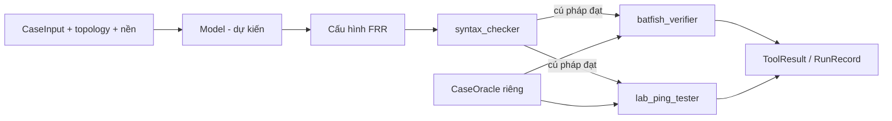

# Nền tảng chặng 02

Chỉ có hợp đồng dữ liệu, CLI validation và preflight. Chưa có bộ điều phối,
model payload builder hay implementation của ba verifier. Python 3.12+,
standard library; chạy trực tiếp bằng PYTHONPATH=src, không cần pip install.



Các mũi tên verifier/model là giao diện dự kiến, chưa chạy. Evaluator chấm
baseline cùng oracle nhưng không trả phản hồi sửa; hai agent dùng feedback khác
nhau, mỗi quỹ đạo tối đa lần sinh 0..5. Chưa có fake verifier hoặc routing simulator.

## Hợp đồng JSON hiện có

Định nghĩa tại `src/a1_intent_routing/contracts.py`. Parser từ chối trường lạ,
trường thiếu và JSON có key trùng (khi nạp qua CLI).

- Topology: `topology_id`, `nodes`, `links`. Node có `name`, `kind` (router/host),
  `interfaces` gồm `name`, `ipv4` dạng địa chỉ/prefix. Link có `a`, `b`, mỗi đầu
  là `{node, interface}`. Interface của một node là duy nhất; IP không trùng;
  hai đầu link cùng subnet, interface không được dùng cho hai link, subnet các
  link không chồng lấn. Interface không nối link được phép để biểu diễn loopback.
  Đây là hợp đồng cho link IPv4 điểm-điểm; chưa mô hình LAN dùng chung/gateway
  hoặc AS/OSPF metadata. Mở rộng có chủ đích khi tạo topology chặng 03.
- CaseInput: `case_id`, `task_group` (static/ospf/ebgp_prefix/path_regression),
  `split` (dev/eval), `intent`, `topology` (đường dẫn JSON tương đối với file
  input), `constraints` (các NetworkCheck do người dùng yêu cầu). Input không
  chứa oracle hay reference answer. Cấu hình nền chưa có loader trong chặng này.
- NetworkCheck: `source`, `destination` mỗi bên `{node, interface, ip}`; IP phải
  khớp interface. `reachability` là boolean, `required_path` là danh sách đầy đủ
  các node theo thứ tự, hoặc `[]` nếu không ràng buộc đường. Các cạnh phải tồn
  tại, đầu/cuối khớp nguồn/đích và không có vòng lặp.
- `direction` bắt buộc `forward`: check chỉ xét source → destination. Chiều
  về phải viết check khác với source/destination/path riêng, không tự đảo tuyến.
  `ecmp` bắt buộc: `all_paths` yêu cầu mọi đường ECMP khả thi thỏa điều kiện;
  `any_path` chỉ yêu cầu ít nhất một đường thỏa. Với reachability=false phải
  chứng minh không có đường tới đích; không dùng any_path để chấp nhận một probe
  thất bại khi vẫn có đường tới đích. required_path khi có là đường node chính
  xác, không phải danh sách waypoint; không cho path với reachability=false.
- CaseOracle riêng: `case_id`, `checks`, `regression_checks` cùng NetworkCheck.
  Oracle chứa kỳ vọng evaluator, không phải chuỗi lệnh cấu hình. Parser hiện
  chưa mô tả thuộc tính RIB/OSPF/BGP; cần mở rộng khi ca yêu cầu chúng. CLI chỉ
  nạp oracle nếu có `--oracle-dir`; kiểm case_id khớp input. Không dùng asdict
  cả gói evaluator để dựng payload model trong triển khai sau.
- ToolResult: tool, status, coverage, unsupported, structured errors
  (`device/property/expected/observed`), artifacts, thời gian. Không hỗ trợ check
  bắt buộc → environment_error; không được âm thầm bỏ check để pass. Dataclass
  kiểm tra tối thiểu khi khởi tạo, không xác thực tính thật của artifact.
- RunRecord: case_id, method, model/settings, trial_index 0..2,
  attempt_index = repair_count 0..5, status, ba nhóm checks, errors, artifacts,
  input/output token và thời gian LLM/tool/tổng. Trường chưa đo là null;
  status=null nghĩa là chưa có kết quả, không phải trạng thái cuối thứ tư.
  Bản ghi là snapshot tích lũy đến vòng hiện tại; status cuối thuộc
  pass/fail/environment_error. One-pass chỉ có vòng 0. Khi status=pass, phải
  có ba nhóm checks có bằng chứng; ca không có regression cần evaluator ghi
  rõ bằng chứng kiểm kê không có regression bắt buộc, không giả chạy probe.
  Đây chưa phải schema lưu trữ hoàn chỉnh hay cơ chế quyết định kết quả.

## CLI và giới hạn

```sh
PYTHONPATH=src python3 -m a1_intent_routing check-inputs data/dev
PYTHONPATH=src python3 -m a1_intent_routing check-inputs path/to/CASE.input.json --oracle-dir path/to/oracles
PYTHONPATH=src python3 -m unittest discover -s tests -v
python3 scripts/preflight.py
```

Directory chỉ tìm `*.input.json`, không tự nạp oracle. Nhiều file kiểm tra
case_id duy nhất trong một lần gọi. Lỗi in file/field ra stderr, exit 1;
thành công in `input_valid`, exit 0. Tập rỗng cũng exit 1 để tránh pass rỗng.
CLI không kiểm split 8/24, phân bố nhóm, syntax FRR, intent thực tế hoặc lab.
Chặng 03 có ba input dev và oracle riêng; lệnh data/dev hiện thành công.
Unit/contract tests dùng fixture tạm hai node, không là ca dev hay kiểm chứng lab.

## Giao diện ba tool dự kiến

| Tool | Đầu vào evaluator | Bằng chứng đầu ra bắt buộc |
| --- | --- | --- |
| syntax_checker | topology, cấu hình theo router, phiên bản FRR, timeout | lỗi parser theo router/dòng, coverage mọi router, log/exit code |
| batfish_verifier | snapshot cấu hình đã qua syntax, topology, CaseOracle, timeout | initIssues, routes/reachability/traceroute; expected/observed, coverage/unsupported |
| lab_ping_tester | lab riêng sạch, cấu hình đã qua syntax, topology, CaseOracle, timeout hội tụ/probe | ping, traceroute, RIB, trạng thái OSPF/BGP; đường đi và regression theo chiều/ECMP |

Tool trả ToolResult; thiếu dependency, chưa triển khai hoặc timeout không phải
pass. Giữ cấu hình lỗi và bằng chứng từng vòng, giữ bất đồng Batfish/lab. Lab
chỉ nạp cấu hình đã qua syntax; chỉ dừng thành công khi đủ các check bắt buộc.
Khả năng FRR/Batfish và chiến lược đo ECMP cần kiểm bằng lab trước triển khai
thật. Preflight chỉ đọc dependency/service local bằng argv list và timeout 5s
mỗi probe (curl 3s); không cài đặt, không in environment/auth, không deploy lab.

## Bổ sung chặng 03

Node có `gateway` tùy chọn, chỉ host; phải trỏ địa chỉ router trực tiếp qua link.
CaseInput có `routing_requirements` công khai; CaseOracle có `routing_checks`
riêng. Mỗi routing property gồm router, protocol static/ospf, prefix subnet thuộc
topology và next_hop kề trực tiếp; OSPF có area 0.0.0.0. Đây là hợp đồng RIB/area
cho evaluator sau này, không phải kiểm chứng route tồn tại hoặc adjacency FULL.
Chưa có model payload builder. Không serialize oracle/solution vào payload tương lai.
